# 📊 Livro de Diagramas Técnicos do Sistema — É Salú (Recrutamento RH)

Este documento reúne todos os diagramas visuais da arquitetura, fluxos de dados, processos de negócio, banco de dados e pipelines do sistema **É Salú**.

Todos os diagramas foram modelados utilizando a sintaxe **Mermaid**, sendo renderizados nativamente pelo GitHub, GitLab e na maioria dos editores Markdown.

---

## Índice dos Diagramas

1. [Diagrama 1: Arquitetura Geral da Solução (Visão de Infraestrutura & Nuvem)](#1-arquitetura-geral-da-solução)
2. [Diagrama 2: Modelo Entidade-Relacionamento (DER / Banco de Dados)](#2-modelo-entidade-relacionamento-der)
3. [Diagrama 3: Fluxo de Autenticação, Registro e RBAC (JWT)](#3-fluxo-de-autenticação-e-autorização-jwt)
4. [Diagrama 4: Fluxo de Triagem Inteligente com IA (Google Gemini 1.5)](#4-fluxo-de-triagem-inteligente-com-ia-gemini)
5. [Diagrama 5: Ciclo de Vida da Candidatura no ATS (Máquina de Estados)](#5-ciclo-de-vida-da-candidatura-ats)
6. [Diagrama 6: Ciclo de Vida e Moderação de Vagas](#6-ciclo-de-vida-e-moderação-de-vagas)
7. [Diagrama 7: Arquitetura de Notificações em Tempo Real (SSE - Server-Sent Events)](#7-arquitetura-de-notificações-em-tempo-real-sse)
8. [Diagrama 8: Pipeline de Integração Contínua e Deploy (CI/CD)](#8-pipeline-de-integração-contínua-e-deploy-cicd)
9. [Diagrama 9: Mapa de Navegação e Responsividade da Interface (Frontend)](#9-mapa-de-navegação-e-rotas-frontend)
10. [Diagrama 10: Diagrama de Classes UML (Clean Architecture)](#10-diagrama-de-classes-uml)
11. [Diagrama 11: Diagrama de Casos de Uso (Atores & Funcionalidades)](#11-diagrama-de-casos-de-uso)
12. [Diagrama 12: Diagramas de Atividades (Processos de Negócio)](#12-diagramas-de-atividades)

---

## 1. Arquitetura Geral da Solução

Representa os componentes do ecossistema e a divisão de responsabilidades entre cliente, frontend estático/dinâmico, API assíncrona, microsserviço de IA e persistência gerenciada.

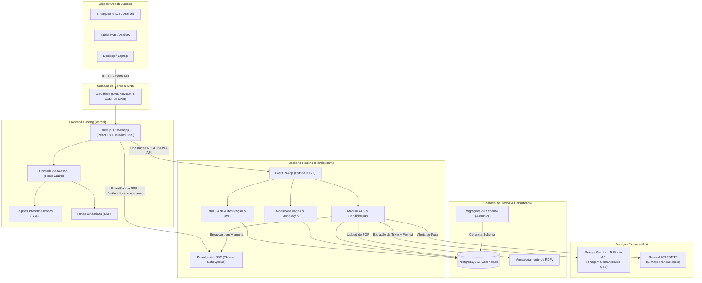

---

## 2. Modelo Entidade-Relacionamento (DER)

Estrutura das tabelas, chaves primárias, tipos de dados, chaves estrangeiras e integridade referencial mantidas no PostgreSQL e mapeadas pelo SQLAlchemy 2.0.

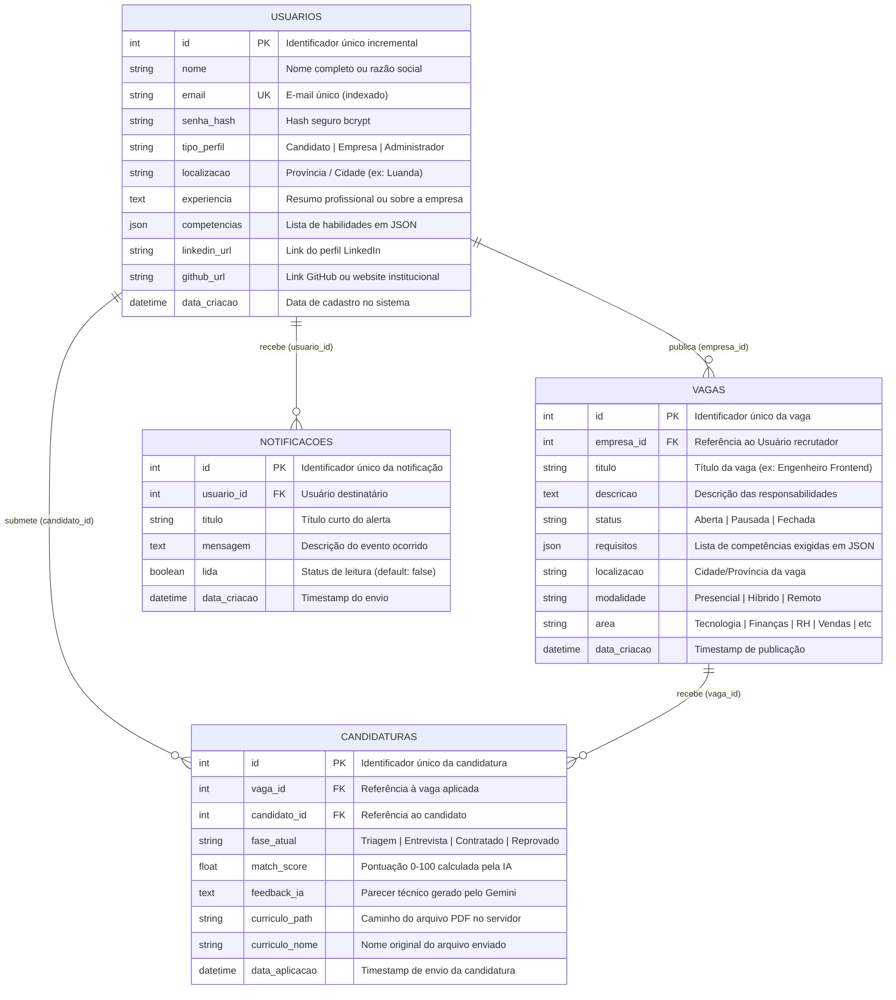

---

## 3. Fluxo de Autenticação e Autorização (JWT)

Detalha os processos de registo com dupla confirmação de senha, login com emissão de token criptográfico e validação RBAC nos endpoints protegidos.

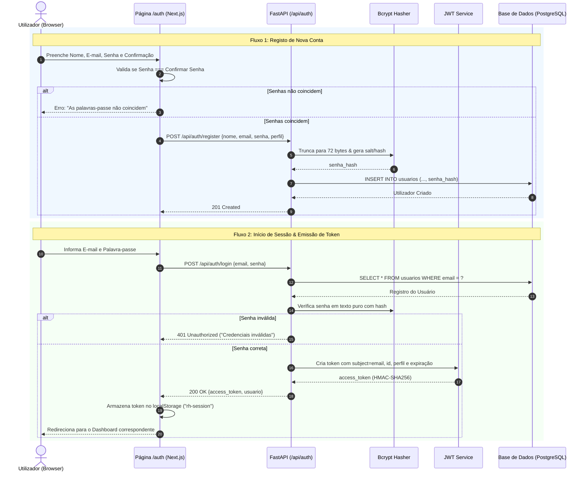

---

## 4. Fluxo de Triagem Inteligente com IA (Gemini)

Demonstra a esteira de processamento que analisa currículos em PDF de forma assíncrona, gerando o parecer técnico e a nota de compatibilidade sem bloquear a requisição do usuário.

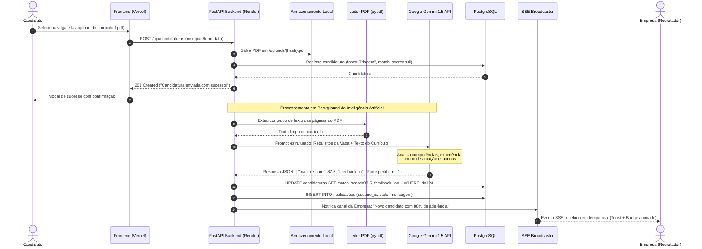

---

## 5. Ciclo de Vida da Candidatura (ATS)

Mostra a máquina de estados que governa a evolução do candidato dentro do funil de recrutamento da empresa, detalhando os gatilhos disparados em cada transição de fase.

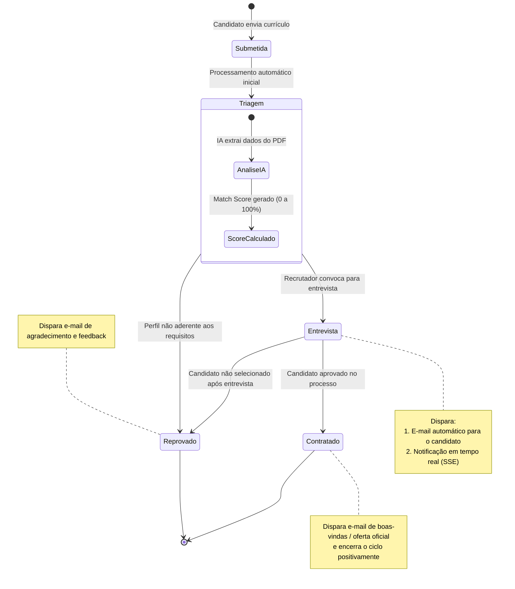

---

## 6. Ciclo de Vida e Moderação de Vagas

Diagrama de estados que representa as fases de uma oportunidade de trabalho e as permissões de moderação da empresa e do administrador da plataforma.

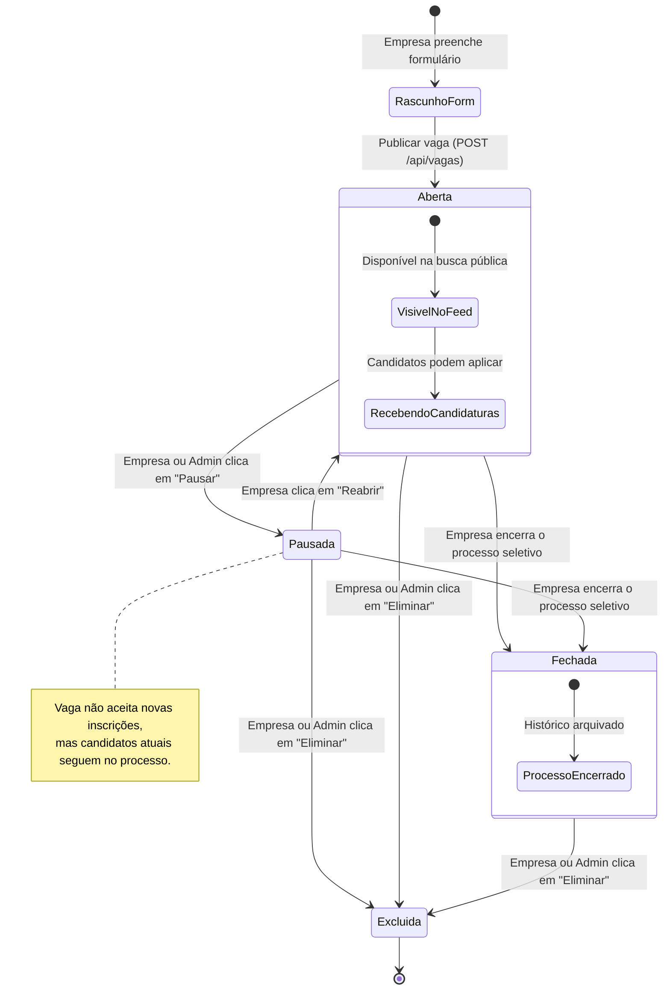

---

## 7. Arquitetura de Notificações em Tempo Real (SSE)

Demonstra a conexão persistente e leve mantida entre os navegadores conectados e o servidor FastAPI via Server-Sent Events, garantindo consumo mínimo de banda e atualização instantânea.

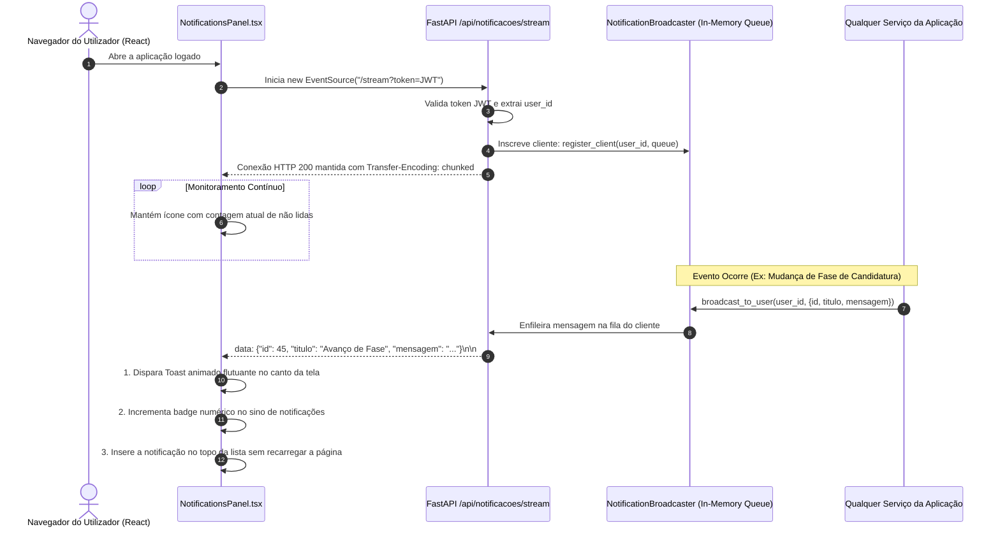

---

## 8. Pipeline de Integração Contínua e Deploy (CI/CD)

Demonstra o fluxo automatizado de integração, teste e publicação contínua desde o commit do desenvolvedor até o ambiente de produção.

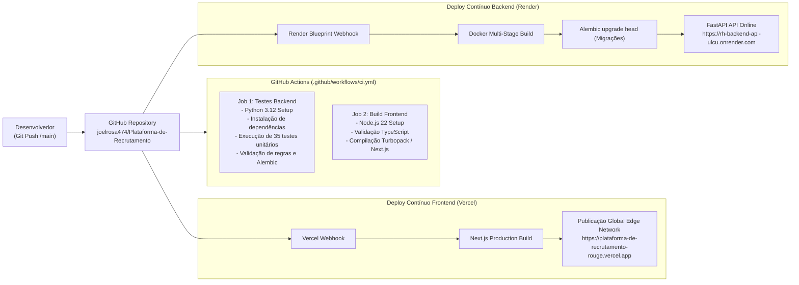

---

## 9. Mapa de Navegação e Rotas (Frontend)

Estrutura de páginas e proteção por rotas implementada no Next.js (App Router), dividida pelos perfis de usuário:

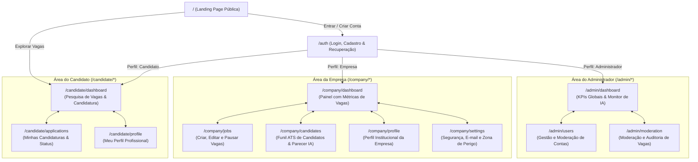

---

## 10. Diagrama de Classes UML

Modela a estrutura orientada a objetos do backend estruturada segundo os princípios da **Clean Architecture** (Arquitetura Limpa), dividida em:
- **Entidades de Domínio (`Domain`):** Modelos puros e desacoplados de frameworks externos.
- **Portas / Interfaces Contratuais (`Ports`):** Contratos de repositórios, serviços de IA e e-mail.
- **Casos de Uso (`Use Cases`):** Orquestração dos fluxos de negócio.
- **Adaptadores Concretos (`Adapters`):** Implementações em SQLAlchemy, Google Gemini, Resend e FastAPI.

```mermaid
classDiagram
    direction TB

    %% Pacote de Domínio
    class Usuario {
        +int id
        +string nome
        +string email
        +string senha_hash
        +string tipo_perfil
        +string localizacao
        +string experiencia
        +List~string~ competencias
        +string linkedin_url
        +string github_url
        +datetime data_criacao
        +verificar_senha(senha_pura: str) bool
        +is_administrador() bool
        +is_empresa() bool
        +is_candidato() bool
    }

    class Vaga {
        +int id
        +int empresa_id
        +string titulo
        +string descricao
        +string status
        +List~string~ requisitos
        +string localizacao
        +string modalidade
        +string area
        +datetime data_criacao
        +pausar() void
        +fechar() void
        +reabrir() void
        +is_aberta() bool
    }

    class Candidatura {
        +int id
        +int vaga_id
        +int candidato_id
        +string fase_atual
        +float match_score
        +string feedback_ia
        +string curriculo_path
        +string curriculo_nome
        +datetime data_aplicacao
        +avancar_fase(nova_fase: str) void
        +definir_resultado_ia(score: float, parecer: str) void
    }

    class Notificacao {
        +int id
        +int usuario_id
        +string titulo
        +string mensagem
        +bool lida
        +datetime data_criacao
        +marcar_como_lida() void
    }

    %% Interfaces / Portas
    class UsuarioRepositoryPort {
        <<interface>>
        +obter_por_id(id: int) Usuario
        +obter_por_email(email: str) Usuario
        +salvar(usuario: Usuario) Usuario
        +listar_todos() List~Usuario~
        +eliminar(id: int) void
    }

    class VagaRepositoryPort {
        <<interface>>
        +obter_por_id(id: int) Vaga
        +listar(filtros: dict) List~Vaga~
        +listar_por_empresa(empresa_id: int) List~Vaga~
        +salvar(vaga: Vaga) Vaga
        +eliminar(id: int) void
    }

    class CandidaturaRepositoryPort {
        <<interface>>
        +obter_por_id(id: int) Candidatura
        +listar_por_vaga(vaga_id: int) List~Candidatura~
        +listar_por_candidato(candidato_id: int) List~Candidatura~
        +salvar(candidatura: Candidatura) Candidatura
    }

    class AIScreenerPort {
        <<interface>>
        +analisar_curriculo(requisitos: List~str~, conteudo_cv: str) dict
    }

    class EmailServicePort {
        <<interface>>
        +enviar_recuperacao_senha(destinatario: str, token: str) void
        +enviar_atualizacao_fase(destinatario: str, vaga_titulo: str, nova_fase: str) void
    }

    %% Casos de Uso
    class AutenticacaoUseCase {
        -UsuarioRepositoryPort usuario_repo
        -EmailServicePort email_service
        +registrar(dados: dict) Usuario
        +login(email: str, senha: str) dict
        +solicitar_recuperacao(email: str) dict
        +redefinir_senha(token: str, nova_senha: str) dict
    }

    class GerenciarVagasUseCase {
        -VagaRepositoryPort vaga_repo
        +criar_vaga(empresa_id: int, dados: dict) Vaga
        +atualizar_vaga(vaga_id: int, dados: dict) Vaga
        +alterar_status(vaga_id: int, status: str) Vaga
        +excluir_vaga(vaga_id: int) void
    }

    class RealizarCandidaturaUseCase {
        -CandidaturaRepositoryPort candidatura_repo
        -VagaRepositoryPort vaga_repo
        -AIScreenerPort ai_screener
        -EmailServicePort email_service
        +submeter_candidatura(candidato_id: int, vaga_id: int, pdf_bytes: bytes) Candidatura
        +avancar_candidato(candidatura_id: int, nova_fase: str) Candidatura
    }

    %% Relacionamentos de Domínio
    Usuario "1" --> "*" Vaga : publica
    Usuario "1" --> "*" Candidatura : submete
    Usuario "1" --> "*" Notificacao : recebe
    Vaga "1" --> "*" Candidatura : recebe

    %% Relacionamentos de Casos de Uso com Portas
    AutenticacaoUseCase ..> UsuarioRepositoryPort : usa
    AutenticacaoUseCase ..> EmailServicePort : usa
    GerenciarVagasUseCase ..> VagaRepositoryPort : usa
    RealizarCandidaturaUseCase ..> CandidaturaRepositoryPort : usa
    RealizarCandidaturaUseCase ..> VagaRepositoryPort : usa
    RealizarCandidaturaUseCase ..> AIScreenerPort : usa
    RealizarCandidaturaUseCase ..> EmailServicePort : usa
```

---

## 11. Diagrama de Casos de Uso

Apresenta as funcionalidades agrupadas por perfil de acesso (Atores), ilustrando as dependências e o papel do assistente de inteligência artificial na triagem.

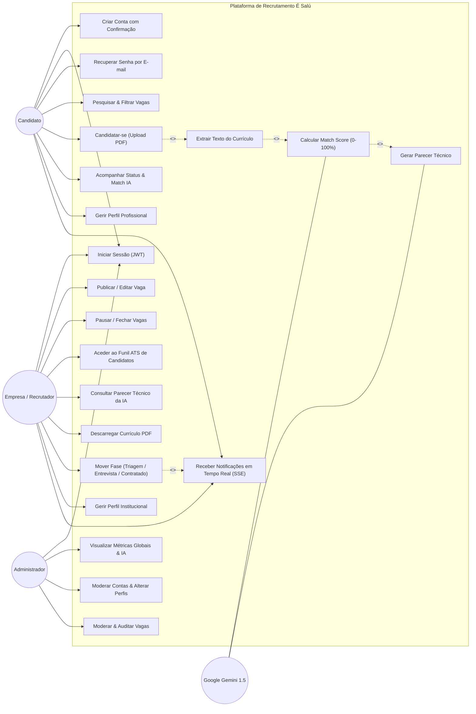

---

## 12. Diagramas de Atividades

Modelam o fluxo lógico e as decisões operacionais dos principais processos de negócio do sistema.

### 12.1. Atividade: Processo de Candidatura e Triagem Automática

Representa o workflow com faixas de responsabilidade (*swimlanes*) desde a submissão do currículo até a disponibilização do score no ATS.

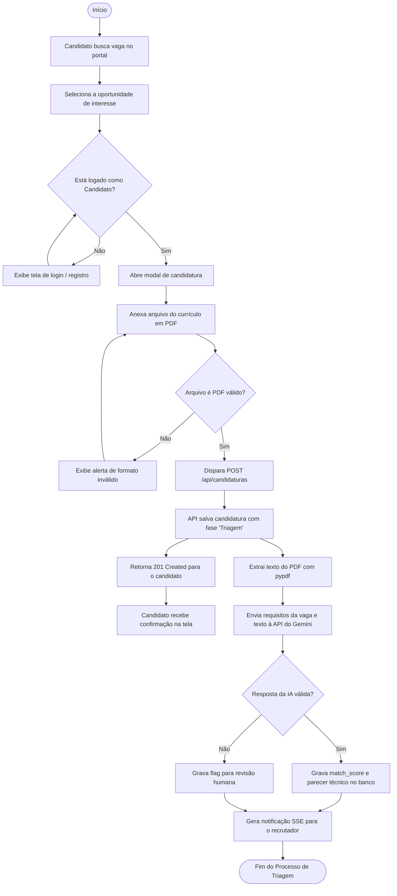

---

### 12.2. Atividade: Publicação e Gestão de Vagas pela Empresa

Ilustra o ciclo operacional do recrutador ao cadastrar, gerenciar o status e encerrar oportunidades.

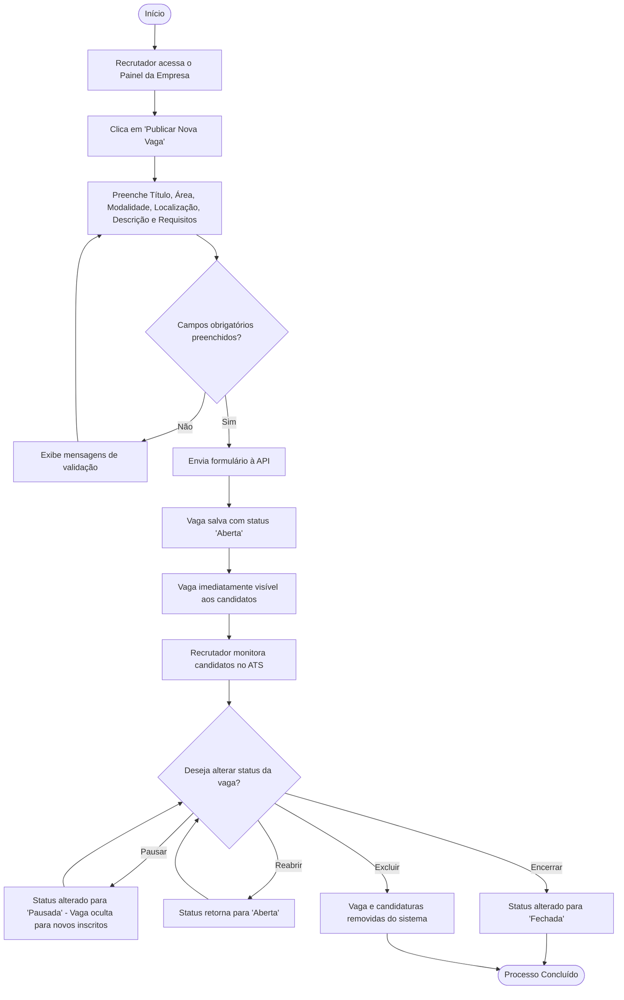

---

### 12.3. Atividade: Transição de Fase no ATS e Comunicação Multicanal

Demonstra o fluxo acionado quando um recrutador move um candidato no funil ATS (ex: de *Triagem* para *Entrevista* ou *Contratado*).

```mermaid
flowchart TD
    Start([Início]) --> ViewATS[Recrutador abre funil ATS da vaga]
    ViewATS --> ReviewCandidate[Analisa perfil, CV em PDF e parecer da IA]
    ReviewCandidate --> SelectNewPhase[Seleciona nova fase: Entrevista, Contratado ou Reprovado]
    SelectNewPhase --> ConfirmChange[Dispara PATCH /api/candidaturas/{id}/fase]

    ConfirmChange --> UpdateDB[API atualiza fase_atual na base de dados]
    UpdateDB --> CreateNotification[Cria registro na tabela NOTIFICACOES]

    %% Disparos Paralelos
    CreateNotification --> TriggerSSE[Broadcaster SSE envia evento em tempo real]
    CreateNotification --> TriggerEmail[EmailService envia e-mail transacional]

    TriggerSSE --> ClientToast[Candidato visualiza Toast flutuante instantâneo]
    TriggerEmail --> ClientInbox[Candidato recebe e-mail na sua caixa postal]

    ClientToast --> SyncBoard[Interface ATS da empresa atualiza status]
    ClientInbox --> SyncBoard
    SyncBoard --> End([Fim do Ciclo de Transição])
```

---

*Livro de Diagramas mantido e versionado no repositório da **É Salú**.*
