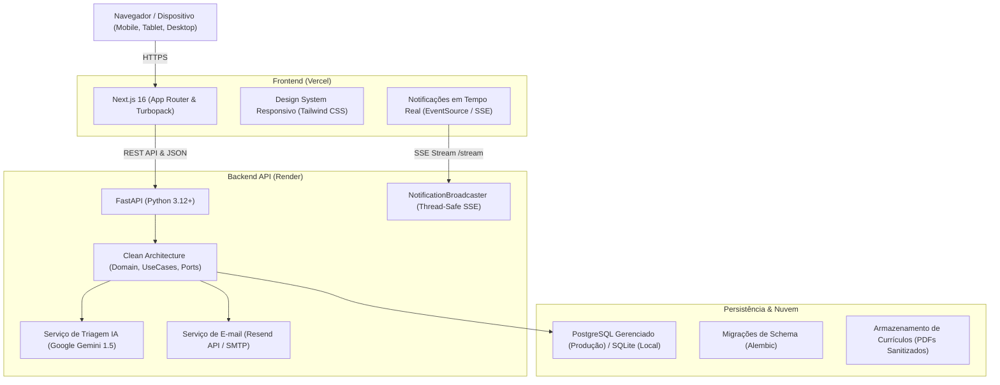
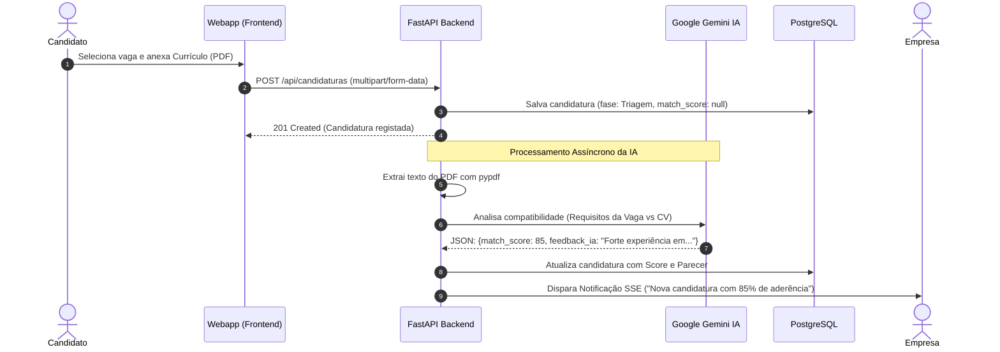
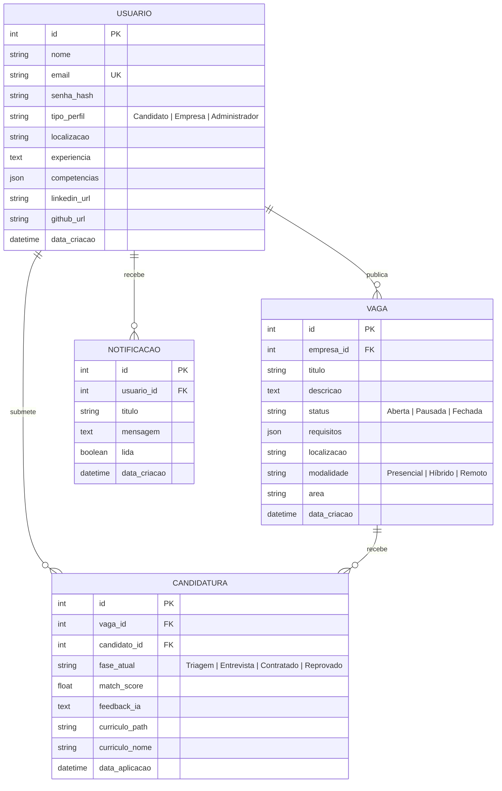

# 📘 Documentação Oficial do Sistema — É Salú (Recrutamento RH)

Bem-vindo à documentação técnica e funcional da **É Salú**, uma plataforma moderna de recrutamento e seleção orientada por Inteligência Artificial (Google Gemini), concebida para conectar candidatos qualificados às melhores empresas de Angola.

> 📊 **Livro Completo de Diagramas:** Para consultar todos os 9 diagramas de arquitetura, banco de dados, fluxos de autenticação, triagem de IA e sequências, aceda a [**`DIAGRAMAS.md`**](DIAGRAMAS.md).

---

## 1. Visão Geral e Objetivos do Produto

A **É Salú** digitaliza e automatiza o ciclo completo de atração, triagem e contratação de talentos. O sistema resolve os principais gargalos dos processos seletivos tradicionais:
- **Para Candidatos:** Interface intuitiva e 100% responsiva (smartphones, tablets e computadores), com candidaturas rápidas via upload de PDF e acompanhamento do status em tempo real.
- **Para Empresas (Recrutadores):** Painel ATS (Applicant Tracking System) com categorização de candidatos por fases (Triagem, Entrevista, Contratado, Reprovado), análise de aderência por IA e download direto dos currículos.
- **Para Administradores:** Painel executivo com métricas de volume, distribuição por modalidade/setores, monitoramento de performance da IA e governança de contas e vagas.

---

## 2. Arquitetura da Solução

O ecossistema foi construído sobre uma arquitetura desacoplada e modular, garantindo escalabilidade, segurança e fácil manutenção:



### Tecnologias Utilizadas

| Camada | Tecnologia | Finalidade |
|---|---|---|
| **Frontend** | Next.js 16 (React 18, TypeScript) | Renderização híbrida rápida e SEO |
| **Estilização** | Tailwind CSS + Lucide Icons | Design moderno, responsivo e adaptável a telas de 320px a 4K |
| **Backend** | FastAPI + Python 3.12+ | API REST assíncrona de alta performance |
| **Arquitetura Backend** | Clean Architecture / Portas & Adaptadores | Separação estrita de regras de negócio e infraestrutura |
| **Base de Dados** | PostgreSQL (Render) / SQLite | Armazenamento relacional com suporte a pools de conexão |
| **ORM & Migrações** | SQLAlchemy 2.0 + Alembic | Modelagem relacional e versionamento de banco |
| **Inteligência Artificial**| Google Gemini Studio API | Extração de texto de PDFs e pontuação semântica (*Match Score*) |
| **Tempo Real** | Server-Sent Events (SSE) | Notificações push leves e sem dependência de websockets pesados |
| **Segurança** | JWT (HMAC-SHA256) + Passlib (bcrypt) | Autenticação stateless com controle de expiração |
| **E-mails** | Resend API + SMTP fallback | Recuperação de senhas e alertas transacionais de contratação |

---

## 3. Perfis de Utilizador e Controlo de Acesso (RBAC)

O sistema implementa 3 níveis de permissão com isolamento em rotas protegidas no frontend (`RouteGuard`) e no backend (`get_current_user`):

### 3.1. Candidato
- Pesquisa de vagas abertas com filtros por palavra-chave, localização (província/cidade), modalidade (Presencial, Híbrido, Remoto) e setor.
- Candidatura com anexo de currículo exclusivamente em formato PDF.
- Acompanhamento do histórico de candidaturas com etiqueta da fase atual e score de compatibilidade calculado pela IA.
- Perfil profissional com competências, links de LinkedIn e GitHub.

### 3.2. Empresa (Recrutador)
- Publicação, edição, pausa e encerramento de vagas de emprego.
- Gestão de candidatos por vaga no formato ATS (Applicant Tracking System).
- Acesso ao parecer técnico detalhado gerado pela IA (Google Gemini).
- Descarregamento seguro do currículo original em PDF.
- Transição de fases do candidato: `Triagem` ➔ `Entrevista` ➔ `Contratado` ou `Reprovado` (com disparo automático de e-mail e notificação SSE para o candidato).

### 3.3. Administrador
- Painel analítico de governança com indicadores chave (KPIs):
  - Total de candidatos e empresas cadastradas.
  - Taxa de adoção da triagem com IA e média geral de compatibilidade.
  - Gráfico de funil de candidatos e distribuição de vagas por modalidade.
- Moderação de utilizadores: promover para Administrador, alterar perfil ou eliminar contas.
- Moderação de vagas: auditar, pausar ou remover vagas em desacordo com as diretrizes da plataforma.

---

## 4. Fluxo Inteligente de Triagem com IA (Google Gemini)



---

## 5. Modelo de Dados (Entidade-Relacionamento)



---

## 6. Referência dos Principais Endpoints da API

Documentação interativa disponível localmente em `http://localhost:8000/docs` ou em produção via Swagger.

### Autenticação & Recuperação (`/api/auth`)
- `POST /api/auth/registrar`: Criar conta de candidato ou empresa. A palavra-passe deve ter entre 8 e 72 bytes.
- `POST /api/auth/login`: Autenticar com formulário OAuth2 (`username` e `password`), emitir token JWT e criar cookie de sessão HttpOnly.
- `POST /api/auth/logout`: Terminar a sessão no navegador.
- `POST /api/auth/recuperar-senha`: Solicitar link de recuperação por e-mail sem revelar se a conta existe.
- `POST /api/auth/redefinir-senha`: Redefinir a palavra-passe com token de recuperação válido.
- `GET` e `PUT /api/auth/me`: Consultar e atualizar o perfil autenticado, incluindo a autorização para aparecer no Banco de Talentos.
- `GET /api/auth/candidatos/{candidato_id}`: Consultar o perfil de um candidato (empresas; requer consentimento público ou candidatura à empresa).
- `PUT /api/auth/me/email`, `PUT /api/auth/me/senha` e `DELETE /api/auth/me`: Gerir e-mail, palavra-passe e conta.

### Vagas (`/api/vagas`)
- `GET /api/vagas`: Listar vagas abertas com suporte a paginação e filtros (`termo`, `localizacao`, `modalidade`, `area`).
- `GET /api/vagas/{id}`: Obter detalhes de uma vaga específica.
- `POST /api/vagas`: Publicar nova vaga (restrito a `Empresa`).
- `PUT /api/vagas/{id}`: Atualizar vaga existente.
- `DELETE /api/vagas/{id}`: Remover vaga e dados associados.

### Candidaturas & ATS (`/api/candidaturas`)
- `POST /api/candidaturas`: Submeter candidatura com upload de PDF.
- `GET /api/candidaturas/minhas`: Histórico de candidaturas do candidato logado.
- `GET /api/candidaturas/vaga/{vaga_id}`: Lista de candidatos da vaga (restrito ao recrutador proprietário).
- `PUT /api/candidaturas/{id}/fase`: Atualizar fase do candidato e disparar notificação.
- `GET /api/candidaturas/{id}/curriculo`: Download seguro do PDF do currículo.
- `PUT /api/candidaturas/{id}/entrevista`: Agendar ou reagendar entrevista; valida data futura, link HTTP(S) opcional e envia notificação/e-mail.
- `POST /api/candidaturas/{id}/roteiro-entrevista`: Gerar roteiro de entrevista com IA para a candidatura.
- `PUT /api/candidaturas/{id}/roteiro-entrevista`: Guardar roteiro, notas e avaliações preparados pelo recrutador.

### Recomendações, vagas e Banco de Talentos
- `GET /api/vagas/busca`: Pesquisa paginada de vagas abertas com filtros.
- `GET /api/vagas/recomendadas`: Sugestões explicáveis para o candidato autenticado, calculadas a partir de competências, experiência e localização.
- `GET /api/vagas/minhas`: Vagas publicadas pela empresa autenticada.
- `PUT /api/vagas/{id}/pausar` e `PUT /api/vagas/{id}/fechar`: Alterar o estado de uma vaga da própria empresa.
- `GET /api/talentos`: Pesquisa paginada no Banco de Talentos, disponível para empresas e limitada a candidatos que consentiram a exposição do perfil.

### Notificações em Tempo Real (`/api/notificacoes`)
- `GET /api/notificacoes/stream`: Conexão contínua Server-Sent Events (SSE) autenticada via token de autorização.
- `GET /api/notificacoes/`: Listagem de notificações armazenadas.
- `PUT /api/notificacoes/{id}/lida`: Marcar notificação individual como lida.
- `PUT /api/notificacoes/ler-todas`: Marcar todas as notificações do utilizador como lidas.

### Administração & Métricas (`/api/admin`)
- `GET /api/admin/resumo`: Resumo analítico com indicadores de IA, taxas de conversão e totais.
- `GET /api/admin/usuarios`: Listagem completa de utilizadores da plataforma.
- `PUT /api/admin/usuarios/{id}/perfil`: Alterar tipo de perfil de utilizador.
- `DELETE /api/admin/usuarios/{id}`: Eliminar utilizador.
- `GET /api/admin/vagas`: Listagem e auditoria de todas as vagas publicadas.
- `PUT /api/admin/vagas/{id}/status`: Moderação do status de uma vaga.

---

## 7. Formato de Erros da API

Todas as respostas de erro usam uma estrutura previsível para que o frontend apresente uma mensagem adequada e a equipa consiga localizar a ocorrência nos logs:

```json
{
  "detail": "Já existe uma candidatura sua para esta vaga.",
  "error": {
    "code": "duplicate_application",
    "message": "Já existe uma candidatura sua para esta vaga.",
    "status": 409,
    "request_id": "a1b2c3d4"
  }
}
```

Em erros de validação (`422`), `error.fields` contém os campos inválidos. O `request_id` também é devolvido no cabeçalho `X-Request-Id`; partilhe-o com o suporte para investigar uma falha sem expor dados pessoais. Erros internos devolvem uma mensagem segura, sem detalhes técnicos da infraestrutura.

---

## 8. Práticas de Segurança e Conformidade

1. **Proteção de Credenciais:** As senhas são protegidas com algoritmos de hash modernos via `bcrypt`. Entradas longas são truncadas com segurança de codificação UTF-8 para respeitar o limite padrão de 72 bytes do bcrypt sem falhas.
2. **Prevenção de Ataques (CORS & Injection):**
   - Política restritiva de CORS configurada com os domínios oficiais da Vercel e portas de desenvolvimento.
   - Consultas à base de dados executadas através do ORM SQLAlchemy com *parameter binding*, eliminando riscos de SQL Injection.
3. **Uploads Seguros:** Apenas ficheiros com cabeçalhos MIME válidos de PDF são aceites na triagem.
4. **Isolamento de Segredos:** Arquivos `.env` protegidos no `.gitignore` para prevenir vazamentos acidentais no repositório de código público.
5. **Sessão e autorização:** O JWT de sessão é mantido em cookie `HttpOnly`; o navegador não o persiste no `localStorage`. Rotas protegidas aplicam perfis de Candidato, Empresa ou Administrador e verificam a posse dos recursos relevantes.
6. **Proteção contra pedidos cross-site:** Pedidos que alteram dados e trazem o cabeçalho `Origin` só são aceites quando a origem constar em `CORS_ORIGINS` ou `API_ORIGIN`. Em produção, configure `API_ORIGIN` com o domínio público do backend; o cookie usa `SameSite=None` e `Secure` para suportar o frontend autorizado num domínio distinto.

---

## 9. Execução e Testes Automatizados

### Rodar a Suite de Testes do Backend
O backend conta com 36 testes automatizados cobrindo autenticação, casos de uso, regras de negócio, serviços de e-mail e streaming SSE:

```powershell
cd backend
.\.venv\Scripts\python.exe -m unittest discover -s tests -p "test_*.py" -v
```

### Rodar o Build de Produção do Frontend
Validação estrita de TypeScript e empacotamento Turbopack:

```powershell
cd webapp
npm run build
```

---

Para instruções orientadas ao uso da plataforma, consulte o [Manual do Utilizador](MANUAL_USUARIO.md).

*Documentação atualizada em 30 de outubro de 2026 pela equipa de engenharia do projeto **É Salú**.*
